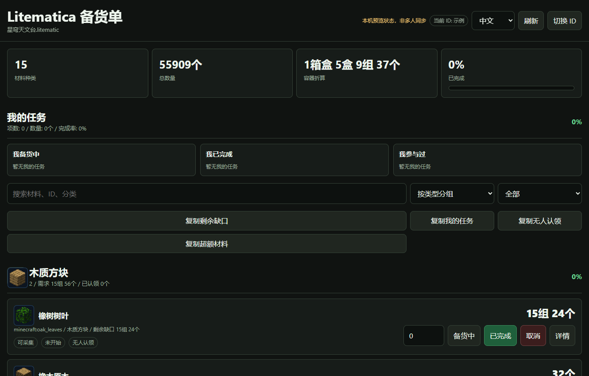
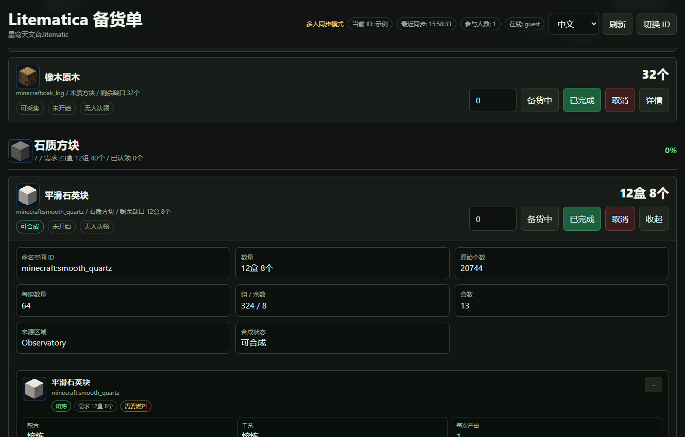
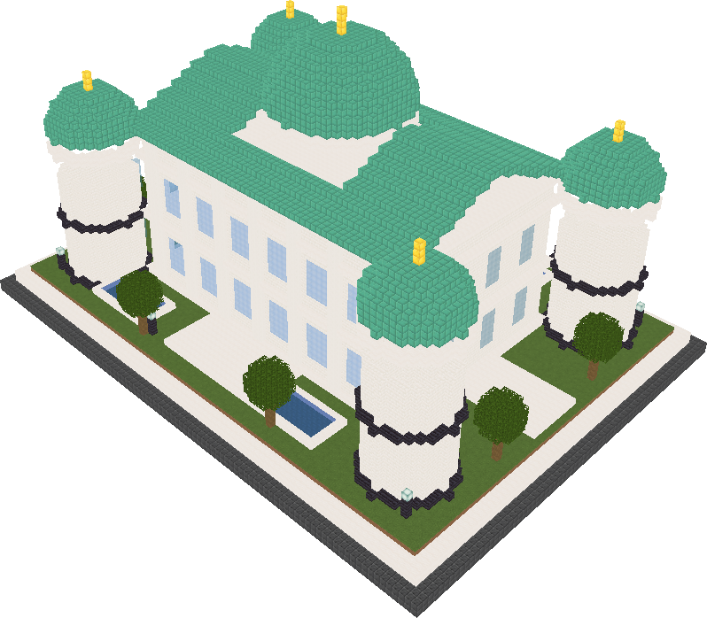

# Litematica-Nova

Litematica-Nova 是给 Minecraft Java 版玩家用的桌面投影工具。不用启动游戏，就能打开 `.litematic`，看看建筑里藏着什么、要带几盒材料，以及下一层该怎么搭。它是独立应用，不是需要放进 `mods` 文件夹的模组。

[下载安装包](https://github.com/LitematicaViewer/Litematica-Nova/releases) · [反馈问题](https://github.com/LitematicaViewer/Litematica-Nova/issues) · 开发交流 QQ 群：1044260630

## 整理投影

在投影库中按分类收纳文件，搜索名称，或拖动多个投影一起归类。卡片上的缩略图方便辨认建筑；如果投影还没有预览图，可以打开三维视图，选好角度后将当前画面设为缩略图。

## 备齐材料

材料清单既能看整个投影，也能按区域或层查看。数量可以直接显示为物品个数，也可以换算为盒、组和散件。箱子、潜影盒等容器里的物品可单独统计，不必把容器内容和建筑用料混在一起。

材料清单可导出为 CSV、文本、网页或 SVG。要给几个投影一起备货时，可以把它们加入同一个备货任务，记录已经备好的数量，下次接着看还差什么。

## 对照施工

先在三维视图中转动模型、查看结构，再切到二维分层图，按高度对照方块的位置。三维视图也可限定显示的高度范围，方便看清封在墙内的线路和部件。需要修改投影时，可以编辑属性、预览方块替换结果，再另存为新文件。

## 开始使用

1. 从[下载页](https://github.com/LitematicaViewer/Litematica-Nova/releases)选择对应系统的安装包：Windows 使用 Setup，Linux 选择 Debian 包或 AppImage，macOS 选择与 Intel 或 Apple Silicon 芯片对应的 DMG。
2. 启动 Nova，点击「打开投影文件」，选择自己的 `.litematic`。
3. 想备料就打开「备货」，想核对某一层就打开「分层」，想看建筑整体就打开「三维」。

[在线投影来源](docs/ONLINE_PROJECTION_SOURCES.md) · [贡献指南](CONTRIBUTING.md)
