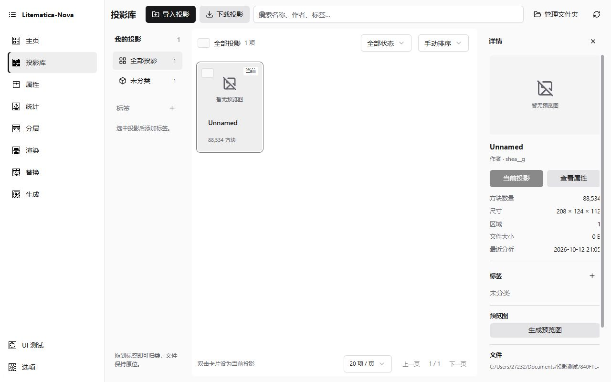
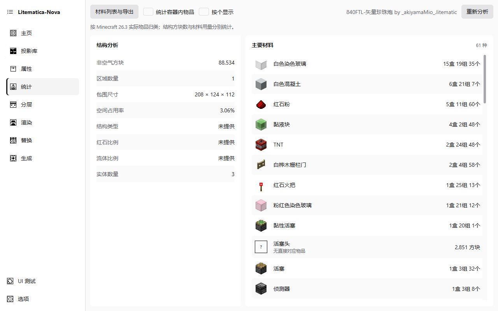

# Litematica-Nova

**不用进入游戏，也能整理投影、查看材料、按层施工。**

面向 Minecraft 玩家的 Windows 桌面工具。打开 `.litematic` 文件，就能查看投影信息和材料清单，也可以修改属性、批量替换方块，或从模板生成一份新投影。

**Beta 0.1 公开测试版 · Windows x64 · 版本 0.1.1**

[反馈问题](https://github.com/LitematicaViewer/Litematica-Nova/issues) · **开发交流 QQ 群：1044260630**

## 为准备材料和施工而设计

- **材料一目了然**：主要材料用图标、中文名称和数量组成清爽列表，支持按区域、按层查看及导出 CSV；可选择统计容器内物品。
- **按自己的习惯计数**：材料可用「箱盒－盒－组－个」或直接数量显示，不用重新分析文件。
- **逐层看清结构**：拖动、缩放、切换层级，用下层半透明参考辅助定位；查看箱子、潜影盒、木桶和漏斗内容。
- **先看影响，再保存**：替换方块和模板生成均可先预览；属性编辑支持另存为。
- **集中管理投影**：左侧按标签筛选，中间查看预览卡片，右侧查看详情；支持搜索、批量选择和拖动归类。「下载投影」直接打开 RedenMC 在线投影库。没有预览图时显示占位，不使用其他图片冒充。
- **三种外观，操作不变**：shadcn/ui 现代简洁，8bitcn/ui 精致像素，Minecraft 保留游戏字体与纹理风格。三主题都支持**浅色、深色、跟随系统**；选择会保存，主窗口和辅助窗口同步更新。
- **属性与预览放在一起**：属性页可直接启动实验性快速渲染，在主窗口内的原生预览区旋转、缩放，查看加载进度与错误，不必先跳转到渲染页。

## 界面预览

三主题共用功能，不必重新学习操作。以下是先前开发阶段留存的截图，展示 **shadcn/ui 浅色主题**；数据由 CLI 读取真实投影后接入，细节以最新测试版为准。

**投影库：标签、预览卡片与详情分区显示。** 原投影文件没有预览图，因此卡片与详情按实际状态显示占位。

**统计页：主要材料以物品图标、中文名称和数量呈现。** 示例使用「投影测试」目录中的真实投影数据。

截图不代表最新版本的视觉或原生 Viewer 验收结果。本轮仅进行 CLI 检查与测试，完整修改交付后统一人工验收。

## 开始使用

1. 从 [Beta 0.1 发布页](https://github.com/LitematicaViewer/Litematica-Nova/releases/tag/beta-0.1.1) 下载 Windows x64 `Setup.exe`，运行安装；所需资源已包含在单个安装包内。安装到所有用户，需要确认 UAC。
2. 点击「打开投影文件」，选择自己的 `.litematic`。它是独立软件，**不需要放进游戏的 mods 文件夹**。
3. 在左侧切换统计、材料、分层等页面。首次尝试修改时，请保留原件，选择「另存为」。

当前版本仅支持 Windows x64；**macOS 和 Linux 将在下个版本支持。** 其他投影格式尚未作为正式发行功能提供。详细变化见 [Beta 0.1 更新说明](docs/releases/BETA_0_1.md)。

## Beta 0.1 进度

| 状态 | 功能 |
| --- | --- |
| 已接入，持续测试 | 打开投影、属性编辑、本地与在线投影库、材料统计和 CSV 导出 |
| 已接入，持续测试 | 方块替换、模板生成 |
| 已接入，待统一验收 | 三主题的浅色/深色/跟随系统、共享控件、响应式排版、滚动条与多窗口同步 |
| 已接入，待统一验收 | 三栏投影库、批量标签整理、属性页与渲染页的独立快速渲染及页内预览区 |
| 部分完成 | 二维分层查看、容器查看、测量，以及原点设置、移动、移除和保存 |
| 未包含在公开版 | 完整模式（FullMode）、Prebuilt、Realtime 与完整光影 |
| 尚未完成 | 格式转换、分层画笔/橡皮/填充/文字，以及方块状态草稿保存 |

### 使用前需要知道

- 属性页使用原有的独立实验性快速渲染，适合查看形体，不是 Full / Realtime，也不承诺完整材质或光影效果。预览区复用原生 Viewer；预览在创建时即属于主窗口的原生子窗口，不使用桌面悬浮窗口、截图或 SetParent。小窗口、DPI 缩放、弹窗遮挡和窗口切换仍需统一人工确认。
- **完整模式未包含在公开版**。属性页与渲染页只开放独立快速渲染；本公开源码和构建依赖不包含商业完整模式、构建服务或光影实现。
- 二维分层是施工参考，不是游戏画面。缺少地图基色时，缩小显示会使用区分色；部分 Mod 方块或状态可能缺图。
- 分层页面的保存只写入**原点修改**。测量、快捷栏与调试棒状态草稿仅在当前会话生效；灰色绘制工具仍是占位。
- 材料以原版 26.3 的实际物品映射为依据；活塞头、流体等没有独立物品的状态只计入结构与单独说明，不伪造物品或重复计料。特殊方块、Mod 内容和自定义物品组件需留意提示，不保证代表生存模式中的全部获取成本。
- 已提供 1643 个静态物品图标，覆盖原版可放置材料对应的全部 1141 种物品。另有 14 种非放置物品的默认着色、组件或场景图标暂未覆盖，仍用问号占位。图标不展示自定义头颅皮肤、附魔动画或季节变化；无直接对应物品的技术方块会单独标注。
- AI 辅助需要额外配置服务、模型及密钥，可能产生费用；Gemini 入口尚未接入。在线投影库依赖网络及第三方服务。

## 更新程序

启动后会在后台检查更新。有新版本时显示版本、日期及新增/优化/修复/注意事项；可以更新、取消，或跳过当前版本。确认更新后显示下载进度，使用签名校验，保存当前草稿并等待后台写任务退出，再安装重启。GitHub 接口失败时切换专用 HTTPS 镜像。

更新源使用 GitHub HTTPS 清单及专用 HTTPS 镜像，下载的是同一签名 NSIS 安装包，不使用便携 EXE 或 ZIP 更新。实际安装与重启仍需用户实机反馈；具体配置见[更新维护说明](docs/UPDATER.md)。

## 一起完善 Nova

遇到问题，请保留原文件和报错，带上「刚才做了什么、期望什么、实际怎样」以及截图，到 [Issues](https://github.com/LitematicaViewer/Litematica-Nova/issues) 或 **QQ 1044260630** 反馈。分享前请遮住密钥及个人信息。

想参与开发或自行构建？请阅读[开发说明](docs/DEVELOPMENT.md)。
